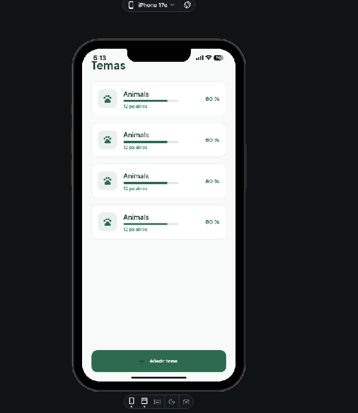
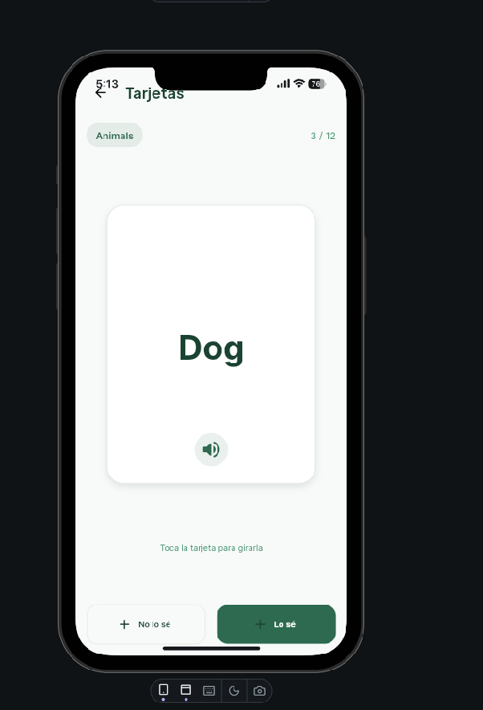
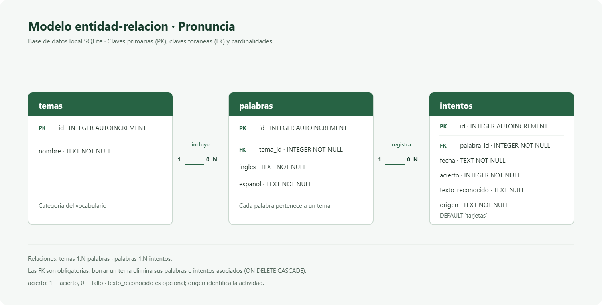
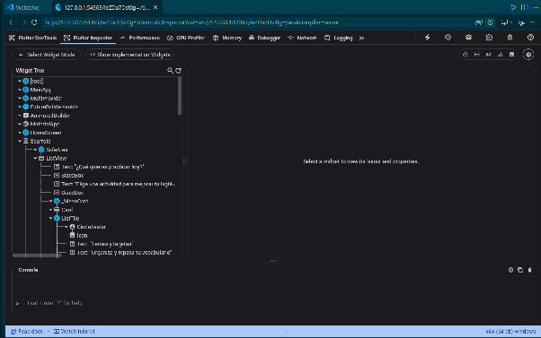
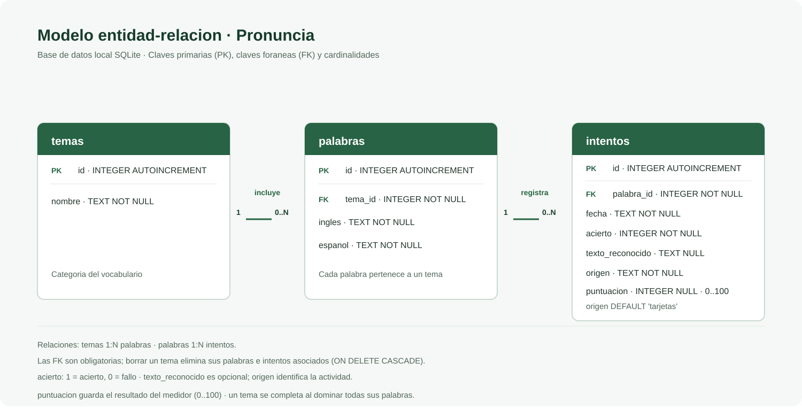
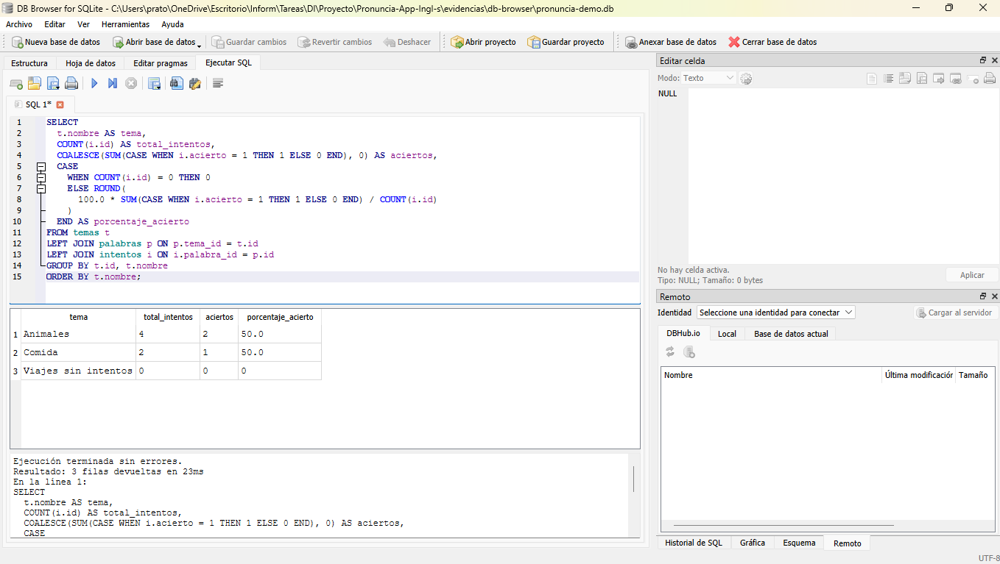
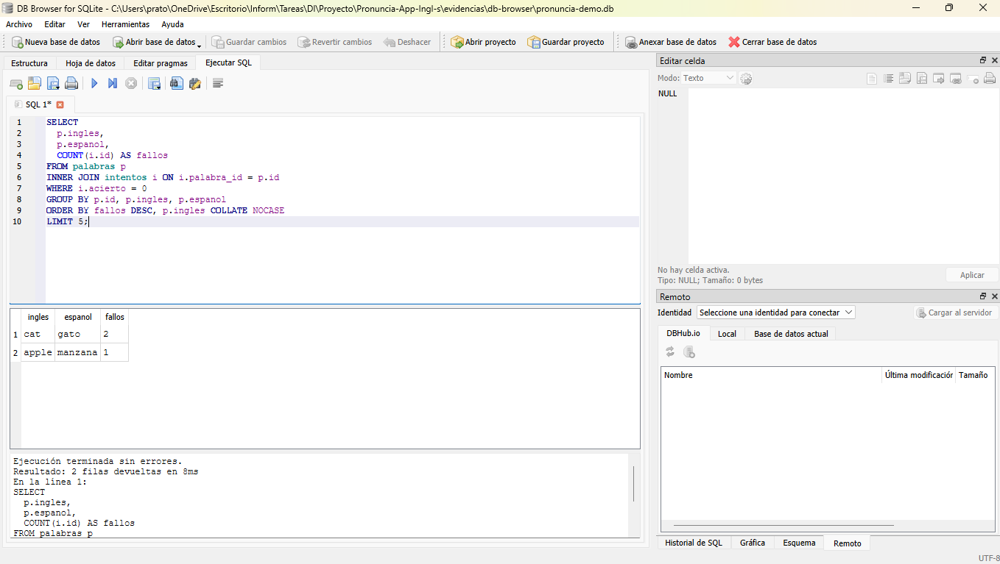

# Memoria razonada: Pronuncia

**Interfaz gráfica (RA1), interfaz natural (RA2) y persistencia SQLite**
Proyecto Flutter · Rama `cambios-finales` · Revisión del código: 12 de noviembre de 2026

## 1. Propósito y valoración general

Pronuncia empezó como una idea sencilla: practicar palabras en inglés sin convertir el aprendizaje en una lista de traducciones. Por eso el proyecto reúne tarjetas, práctica oral, voz sintetizada, traducción, ejercicios con la cámara y estadísticas. Las palabras y los intentos se guardan en SQLite; las preferencias visuales y la velocidad de voz se guardan en el propio dispositivo.

La aplicación cuenta con tema Material 3 claro y oscuro, más de diez pantallas, estado compartido con `ChangeNotifier`, cámara y modelos de visión, y una base de datos relacional que alimenta las estadísticas.

### Resumen de cumplimiento

| Bloque | Criterio | Valoración basada en el repositorio |
|---|---|---|
| A | a | Cumplido |
| A | b | Cumplido: se incluyen capturas del prototipo FlutterFlow |
| A | c | Parcial: se incluyen una captura del Flutter Inspector y extractos de código, pero la documentación de las funciones del editor no está del todo completa |
| A | d–e | Cumplidos |
| A | f–g | Parciales: hay layout adaptable y eventos básicos; la implementación de todos los requisitos de estos criterios no está del todo completa |
| A | h | Cumplido |
| B | a | Cumplido |
| B | b–c | Parciales: hay feedback y alternativas táctiles, pero la integración de las acciones de voz no está del todo completa |
| B | d–e | Cumplidos |
| B | f | Cumplido: ARCore/ARKit detecta planos y coloca un marcador 3D anclado |
| B | g | Parcial: los permisos y la liberación de recursos están implementados, pero la información de privacidad no está del todo completa |
| C | 1–5, 7 | Cumplidos |
| C | 6 | Parcial: el registro en la base de datos de toda la actividad de la interfaz natural no está del todo implementado |

## 2. Bloque A · Interfaz gráfica (RA1)

### 2.1 Herramientas, bibliotecas y decisión (RA1.a)

Antes de elegir la interfaz, comparamos las opciones que mejor encajaban con una aplicación Flutter:

| Opción | Ventajas | Costes o límites | Decisión para Pronuncia |
|---|---|---|---|
| **Material 3 (Flutter)** | Widgets adaptables, accesibles y consistentes; `ColorScheme` genera una paleta relacionada; integración directa con Flutter. | Convenciones visuales Android; para iOS puede resultar menos nativo que Cupertino. | Elegida para las pantallas y el tema de la aplicación. |
| **Cupertino (Flutter)** | Controles y convenciones visuales familiares para iOS. | Mezclar dos sistemas visuales aumenta el trabajo de mantener estilos y coherencia en una app multiplataforma. | No se usa como sistema principal; se podría reservar para controles específicos de iOS. |
| **FlutterFlow** | Prototipado visual rápido y generación inicial de pantallas Flutter. | La edición avanzada y la lógica de cámara/SQLite pueden requerir código; el plan gratuito y la exportación condicionan el flujo. | Se utilizó para prototipar las pantallas de temas y tarjetas; se adjuntan capturas del resultado. |
| **Flutter Inspector / DevTools** | Inspecciona el árbol, las restricciones y las reconstrucciones; ayuda a diagnosticar problemas de layout. | Es una herramienta de desarrollo, no un sistema de diseño ni un generador de interfaz. | Se adjunta una captura del árbol de widgets durante la ejecución de la aplicación. |

Para la interfaz elegimos **Material 3** porque ofrece componentes listos para una app móvil y ayuda a mantener un aspecto consistente. Cupertino también sería una opción válida para una app exclusivamente iOS, pero aquí mezclar los dos estilos habría complicado conservar el mismo diseño en todas las pantallas.

Para guardar los datos elegimos **SQLite**, con `sqflite` en móvil y `sqflite_common_ffi` en escritorio y pruebas. No hace falta un servidor para conservar el vocabulario, y las relaciones entre temas, palabras e intentos nos permiten calcular estadísticas con SQL. Dejamos `shared_preferences` para ajustes sencillos —como el tema y la velocidad de voz—, que no necesitan tablas ni relaciones.

### 2.2 Prototipado y evidencia del editor (RA1.b y RA1.c)

Para explorar la distribución de las pantallas preparamos en **FlutterFlow** un prototipo de dos vistas: la lista de temas y la tarjeta de vocabulario. En el prompt pedimos un estilo Material 3 verde, tarjetas redondeadas, navegación entre ambas pantallas y un botón para escuchar la palabra. Las capturas muestran el resultado del prototipo y el diseño de la tarjeta al entrar en «Animals».

El prototipo fue un punto de partida visual, no el código completo de la aplicación. La app final se desarrolló y amplió en Flutter con persistencia SQLite, voz y funciones de cámara. Por eso hay diferencias entre el prototipo —que usa datos de ejemplo como «12 palabras» y «80 %»— y la aplicación real.

También se incluye una captura del **Flutter Inspector** con el árbol de widgets y otra del menú en ejecución en el móvil. El código contiene widgets reutilizables, como `_MenuCard` en `lib/views/home_screen.dart` y `FlipCard` / `_CardFace` en `lib/widgets/flip_card.dart`. A continuación se muestran extractos reales relacionados con esos patrones.

| Evidencia | Captura |
|---|---|
| FlutterFlow: pantalla de temas |  |
| FlutterFlow: tarjeta de vocabulario |  |
| Flutter Inspector: árbol de widgets |  |
| Aplicación final en el móvil |  |

### Extractos de código para los criterios del editor

**Composición adaptable con `Wrap` (patrón relacionado con *Wrap with*).** En el contador, los once botones se distribuyen en varias filas según el ancho disponible. Así evitamos que una fila fija se salga de la pantalla:

`lib/views/finger_count_screen.dart`

```dart
Wrap(
  spacing: 8,
  runSpacing: 8,
  children: List.generate(
    11,
    (number) => ChoiceChip(
      label: Text('$number'),
      selected: _detectedCount == null && _manualCount == number,
      onSelected: (_) => setState(() {
        _detectedCount = null;
        _manualCount = number;
      }),
    ),
  ),
)
```

**Widget extraído y reutilizado (patrón relacionado con *Extract Widget*).** El menú construye una tarjeta para cada actividad y delega su presentación en `_MenuCard`, de modo que el marcado visual no se repite en cada opción:

`lib/views/home_screen.dart`

```dart
for (final option in options) ...[
  _MenuCard(option: option),
  const SizedBox(height: 12),
]
```

```dart
class _MenuCard extends StatelessWidget {
  const _MenuCard({required this.option});
  final _MenuOption option;

  @override
  Widget build(BuildContext context) {
    final colorScheme = Theme.of(context).colorScheme;
    return Card(
      margin: EdgeInsets.zero,
      shape: RoundedRectangleBorder(
        borderRadius: BorderRadius.circular(16),
        side: BorderSide(color: colorScheme.outlineVariant),
      ),
      child: ListTile(
        contentPadding: const EdgeInsets.symmetric(horizontal: 16, vertical: 8),
        leading: CircleAvatar(
          backgroundColor: colorScheme.secondaryContainer,
          foregroundColor: colorScheme.primary,
          child: Icon(option.icon),
        ),
        title: Text(
          option.title,
          style: const TextStyle(fontWeight: FontWeight.w600),
        ),
        subtitle: Text(option.subtitle),
        trailing: const Icon(Icons.chevron_right_rounded),
        onTap: option.onTap,
      ),
    );
  }
}
```

**Estructura de pantalla y formulario (ejemplo de plantilla y patrón reutilizable de código).** Las pantallas siguen una base reconocible de `Scaffold`, barra superior y contenido; el formulario añade validación y una acción para guardar:

`lib/views/add_word_screen.dart`

```dart
return Scaffold(
  appBar: AppBar(title: const Text('Nueva palabra')),
  body: Form(
    key: _formKey,
    child: ListView(
      padding: const EdgeInsets.all(20),
      children: [
        Text(
          'Añadir a ${widget.tema.nombre}',
          style: Theme.of(context).textTheme.titleLarge?.copyWith(
            color: Theme.of(context).colorScheme.primary,
            fontWeight: FontWeight.w700,
          ),
        ),
        const SizedBox(height: 24),
        TextFormField(
          controller: _englishController,
          autofocus: true,
          textCapitalization: TextCapitalization.sentences,
          decoration: const InputDecoration(
            labelText: 'Palabra en inglés',
            border: OutlineInputBorder(),
          ),
          validator: _required,
          textInputAction: TextInputAction.next,
        ),
        const SizedBox(height: 16),
        TextFormField(
          controller: _spanishController,
          textCapitalization: TextCapitalization.sentences,
          decoration: const InputDecoration(
            labelText: 'Traducción al español',
            border: OutlineInputBorder(),
          ),
          validator: _required,
          textInputAction: TextInputAction.done,
          onFieldSubmitted: (_) => _save(),
        ),
        const SizedBox(height: 24),
        SizedBox(
          height: 52,
          child: FilledButton.icon(
            onPressed: _isSaving ? null : _save,
            icon: _isSaving
                ? const SizedBox.square(
                    dimension: 18,
                    child: CircularProgressIndicator(strokeWidth: 2),
                  )
                : const Icon(Icons.save_outlined),
            label: const Text('Guardar palabra'),
          ),
        ),
      ],
    ),
  ),
);
```

Estos extractos muestran la composición adaptable, la separación de un widget reutilizable y una estructura de formulario.

### 2.3 Tema visual y reconstrucción del árbol (RA1.d y RA1.e)

La aplicación arranca en `lib/main.dart`: `main()` llama a `runApp(const MainApp())`, que crea el primer árbol de widgets. En `MainApp`, `build()` prepara los proveedores y, cuando se han cargado los ajustes, muestra el `MaterialApp`. El tema parte de `ThemeData` y `ColorScheme.fromSeed` con Material 3; hay una variante clara y otra oscura, y la selección se conserva entre usos.

Cuando cambia algo dentro de una pantalla —por ejemplo, al voltear una tarjeta—, `setState()` actualiza su estado y Flutter vuelve a construir la parte necesaria del árbol. Para los datos compartidos, `AppSettingsController` y `DemoStudyController` extienden `ChangeNotifier`. Al llamar a `notifyListeners()`, avisan a los widgets que escuchan esos cambios mediante `Provider` y `context.watch`. De esta forma, cada pantalla puede actualizarse sin tener que reconstruir manualmente toda la aplicación.

### 2.4 Código, eventos y navegación (RA1.f–RA1.h)

- **Código y layout (RA1.f).** El prototipo de FlutterFlow ayudó a concretar las dos primeras vistas, pero la aplicación final está escrita en Flutter y contiene widgets reutilizables. Para que el contenido se adapte mejor al móvil, se usan listas desplazables (`ListView`) y `Wrap` en el selector de números.
- **Eventos (RA1.g).** Los botones ejecutan acciones con `onPressed`, los formularios y selectores reaccionan con `onChanged` y un `GestureDetector` permite tocar una tarjeta para girarla.
- **Navegación y patrón (RA1.h).** La app usa `Navigator.push` y `MaterialPageRoute`; al elegir un tema, `TopicsScreen` envía el objeto `Tema` a `WordListScreen`. Hay más de diez pantallas entre el menú, vocabulario, práctica, cámara y estadísticas. El código separa modelos, vistas, controladores y repositorios, y utiliza `Provider` y `ChangeNotifier` para compartir el estado. Es una organización inspirada en MVC, adaptada a la forma habitual de trabajar con Flutter.

## 3. Bloque B · Interfaz natural (RA2)

### 3.1 Comparación de tecnologías (RA2.a)

| Tecnología | Privacidad | Coste | Latencia | Plataformas / encaje |
|---|---|---|---|---|
| **Google ML Kit** | Inferencia en el dispositivo para las funciones usadas; no exige enviar cada imagen a un servidor. Algunos modelos o funciones pueden descargarse. | Sin coste por inferencia en las funciones locales; hay que considerar tamaño y compatibilidad de paquetes. | Baja, al procesar localmente; depende del dispositivo. | Especialmente adecuado para Android/iOS y para visión móvil. Pronuncia lo usa para etiquetas de imagen y detección de poses; la traducción ML Kit se ejecuta en el dispositivo con modelos descargables. |
| **TensorFlow Lite / LiteRT** | Local, con control del modelo y de los datos. | Sin coste por llamada a nube; se asumen desarrollo, optimización y distribución del modelo. | Baja si el modelo y el hardware están optimizados. | Android/iOS y otras plataformas mediante runtimes o plugins; adecuado si se necesita entrenar/seleccionar un modelo propio. |
| **MediaPipe** | Procesamiento local y salida de landmarks, útil para no compartir imágenes. | Sin coste por petición; coste de integración y compatibilidad. | Adecuada para visión en tiempo real cuando el modelo y dispositivo lo soportan. | Android, iOS, web y otras integraciones. Encaja con landmarks de manos; Pronuncia usa el paquete `hand_landmarker` para contar dedos. |
| **Modelo en la nube** | La imagen o audio sale del dispositivo; exige informar, proteger y limitar el tratamiento de datos. | Puede cobrar por uso, almacenamiento o tráfico. | Depende de red, carga y región; necesita conexión. | Amplia si existe API, pero introduce dependencia de conectividad y servicio. No se eligió para las funciones de visión. |

Para Pronuncia priorizamos el procesamiento en el dispositivo: las imágenes no tienen que viajar a un servidor y la respuesta no depende de la conexión. ML Kit se ocupa de las etiquetas de objetos y las poses; `hand_landmarker`, de localizar los puntos de la mano para contar dedos. La elección también tiene un coste: hay que aceptar las limitaciones de precisión y compatibilidad de cada modelo. El resultado orienta al estudiante, pero no siempre será correcto.

### 3.2 Interacción, feedback, acciones y límites (RA2.b–RA2.f)

| Interacción | Feedback y alternativa | Persistencia / estado |
|---|---|---|
| **Voz** (`speech_to_text`) | Indicador/botón de escucha, transcripción visible y campo para escribir la respuesta si no se usa el micrófono. | La práctica oral compara una respuesta con la palabra elegida y guarda el intento. El medidor guarda texto reconocido y puntuación derivada. |
| **Manos** (`hand_landmarker`) | Vista previa, landmarks superpuestos y contador; hay chips táctiles de 0 a 10 como alternativa al gesto. | El usuario puede guardar el intento del número. |
| **Pose** (ML Kit Pose Detection) | Instrucción, vista de cámara y resultado correcto/incorrecto al pulsar «Comprobar pose». En plataformas sin cámara hay un flujo de simulación. | El intento se registra con origen `pose`. |
| **Objetos / RA** | El usuario pulsa para identificar; puede elegir entre etiquetas candidatas, ver la confianza y escuchar la palabra. En AR toca un plano detectado para colocar el marcador 3D y puede retirarlo. | La pantalla combina identificación de objetos y colocación del marcador 3D. |

La parte de voz permite responder a una palabra que aparece en pantalla y ver la transcripción. Cuando el estudiante comprueba la respuesta, el intento se guarda en la base de datos. `flutter_tts` reproduce palabras y frases en inglés o español. También es importante entender qué mide el medidor: compara texto reconocido con texto esperado, no evalúa los sonidos ni el acento de la persona.

En Simon Says, la cámara y ML Kit comprueban si la postura coincide con la instrucción. En la pantalla de dedos, `hand_landmarker` localiza los puntos de una o dos manos y estima un número de 0 a 10. Para reducir los cambios bruscos entre fotogramas, se toma como resultado el número más frecuente de las últimas cinco detecciones. Los chips permiten seleccionar el número manualmente. Son usos concretos de los puntos corporales, no una superposición decorativa.

La pantalla de cámara ofrece dos modos: identificar objetos y colocarlos en una vista AR. En esta última, `ARView` detecta planos horizontales y, al tocar uno, crea un `ARPlaneAnchor` y coloca sobre él un marcador 3D local (`pronuncia_marker.gltf`). El nombre y la traducción aparecen además en una etiqueta 2D fija en la interfaz; esa etiqueta no sigue la posición espacial del objeto. La persona puede retirar el marcador desde la propia pantalla. Por tanto, el prototipo incluye colocación espacial del marcador, aunque no ancla el texto de la traducción.

Antes de abrir la cámara se solicita permiso con `permission_handler`; para voz se utiliza `speech_to_text` y se declara el permiso de micrófono en Android. En la pantalla de objetos se explica que la imagen se procesa en el dispositivo y no se envía a un servidor. Al salir de las pantallas se liberan los recursos usados —cámara, detectores, reconocimiento y síntesis de voz, suscripciones y controladores de texto— desde `dispose()`.

## 4. Bloque C · Base de datos SQLite

### 4.1 Modelo entidad–relación

Organizamos los datos en tres tablas para que cada una tenga una función clara: `temas` agrupa el vocabulario, `palabras` guarda las traducciones e `intentos` conserva la actividad del estudiante. Un tema puede tener varias palabras y una palabra puede acumular varios intentos. Las claves ajenas mantienen esas relaciones y eliminan los datos dependientes si se borra un tema o una palabra.



### 4.2 Esquema y ciclo de vida

`DatabaseHelper` se encarga de abrir y preparar la base. La app usa una instancia predeterminada (`DatabaseHelper.instance`), aunque las pruebas pueden pasar su propia base. Al abrirla activa `PRAGMA foreign_keys = ON`, crea las tablas en `onCreate` y aplica cambios de esquema desde `onUpgrade`; la versión actual es la 5. Las migraciones conservan la compatibilidad con versiones anteriores, añaden el origen del intento, cargan el catálogo inicial y agregan la puntuación del medidor cuando corresponde.

Este es el esquema que utiliza la aplicación:

```sql
CREATE TABLE temas (
  id INTEGER PRIMARY KEY AUTOINCREMENT,
  nombre TEXT NOT NULL
);

CREATE TABLE palabras (
  id INTEGER PRIMARY KEY AUTOINCREMENT,
  tema_id INTEGER NOT NULL,
  ingles TEXT NOT NULL,
  espanol TEXT NOT NULL,
  FOREIGN KEY (tema_id) REFERENCES temas(id) ON DELETE CASCADE
);

CREATE TABLE intentos (
  id INTEGER PRIMARY KEY AUTOINCREMENT,
  palabra_id INTEGER NOT NULL,
  fecha TEXT NOT NULL,
  acierto INTEGER NOT NULL,
  texto_reconocido TEXT,
  origen TEXT NOT NULL DEFAULT 'tarjetas',
  puntuacion INTEGER CHECK (
    puntuacion IS NULL OR puntuacion BETWEEN 0 AND 100
  ),
  FOREIGN KEY (palabra_id) REFERENCES palabras(id) ON DELETE CASCADE
);
```

### 4.3 Modelos, CRUD, datos iniciales e informes

Los modelos `Tema`, `Palabra` e `Intento` convierten los datos entre Dart y SQLite con `toMap()` y `fromMap()`. Para no mezclar las consultas con la interfaz, el acceso a datos se reparte entre `TemaRepository`, `PalabraRepository` e `IntentoRepository`. Cada uno permite crear, consultar, actualizar y eliminar registros. Cuando una consulta recibe un valor, lo pasa mediante `whereArgs` (o parámetros SQL), en lugar de concatenarlo dentro de la sentencia.

Al instalar la aplicación por primera vez se crea un catálogo con cinco temas y **24 palabras**: animales, comida, colores, números e instrucciones para Simon Says. No se inventan intentos de práctica. Para enseñar cómo funcionan los informes sin mezclar resultados ficticios con los de un estudiante, se incluye una base de demostración independiente en `evidencias/db-browser/pronuncia-demo-v5.db`.

Las estadísticas aprovechan las relaciones entre las tablas. `obtenerEstadisticasPorTema()` usa `LEFT JOIN`, `COUNT` y `SUM`; así también aparecen los temas que todavía no tienen intentos. `obtenerPalabrasMasFalladas()` usa `INNER JOIN` y cuenta las respuestas incorrectas. Además, `obtenerProgresoPorTema()` cuenta las palabras con al menos un acierto. La pantalla de temas usa ese resultado para mostrar cuántas palabras se han dominado y cuándo se completa un tema. Estos resultados aparecen en las pantallas de estadísticas y temas; las capturas de DB Browser enseñan las dos consultas de informes:





La base guarda los intentos de práctica oral (`voz`), del medidor (`pronunciacion`), de contar dedos (`dedos`) y de Simon Says (`pose`); cuando hay una respuesta reconocida también conserva su transcripción. Además, el resultado porcentual del medidor se guarda en `puntuacion`, con una restricción que permite únicamente valores de 0 a 100.

## 5. Conclusión

En conjunto, las decisiones encajan con el objetivo del proyecto: Material 3 da una apariencia coherente, los modelos locales permiten usar la cámara sin enviar imágenes a un servidor y SQLite conserva el vocabulario y los resultados de práctica. Las relaciones, migraciones, repositorios y consultas estadísticas están implementados. Las capturas muestran el prototipo de FlutterFlow, el árbol inspeccionado en Flutter Inspector y la app real en funcionamiento.

**Referencias del proyecto:** `lib/main.dart`, `lib/controllers/`, `lib/data/`, `lib/models/`, `lib/views/`, `lib/widgets/`, `pubspec.yaml`, `evidencias/db-browser/` y `docs/evidencias-editor/`.
